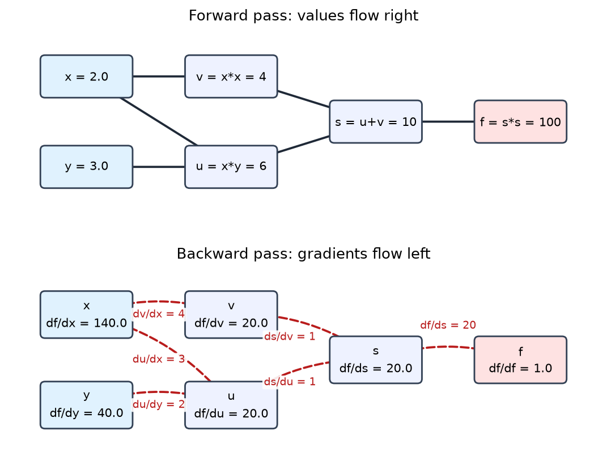
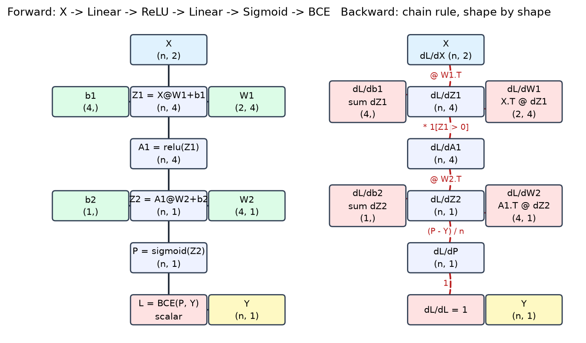

# Jotang ML Task 3：计算图与反向传播

用两个练习把「手算梯度」这件事从头走一遍，每一步都和 PyTorch autograd 对齐：

- **实践 1**：`f(x, y) = (xy + x^2)^2`，把计算拆成基本步骤、画计算图、按图从后往前求梯度；
- **实践 2**：两层二分类网络 `X -> Linear -> ReLU -> Linear -> Sigmoid -> BCE`，用 NumPy 手写前向与反向，
  再和 PyTorch 的 autograd 逐项比较形状、数值和最大绝对误差。

> 纯文本里的 `(xy+x2)2` 丢掉了上标。这里按 `f(x, y) = (xy + x^2)^2` 理解：
> `x*y` 和 `x*x` 两条支路汇合相加后整体平方。（若原意是 `(xy + x)^2`，只需改一行代码。）

## 目录结构

```
.
├── graph_draw.py                       # 画计算图的小工具（matplotlib 方框 + 箭头）
├── text_util.py                        # 中文/英文混排时的对齐辅助函数
├── requirements.txt
├── practice1_simple_chain/
│   ├── f_xy_chain_rule.py              # 实践 1：拆步骤 + NumPy 手算反向 + 三重对照
│   ├── computation_graph.png           # 计算图（上：前向数值；下：反向梯度）
│   └── output.txt                      # 完整运行报告
└── practice2_nn_gradients/
    ├── nn_gradients.py                 # 实践 2：NumPy 前向/反向 + PyTorch autograd 对照
    ├── computation_graph.png           # 计算图（左：前向；右：反向，节点标注形状）
    └── output.txt                      # 完整运行报告
```

## 环境与运行

```bash
pip install -r requirements.txt
# 只装 CPU 版 torch 就够了：
# pip install torch --index-url https://download.pytorch.org/whl/cpu

python practice1_simple_chain/f_xy_chain_rule.py
python practice2_nn_gradients/nn_gradients.py
```

两个脚本都会做同一件事：把完整报告打印到控制台、写进同目录的 `output.txt`，并把计算图存成
`computation_graph.png`。脚本里所有随机量都用固定种子，跑出来每次都一样。

---

## 实践 1：简单计算链 `f(x, y) = (xy + x^2)^2`

取 `x = 2, y = 3`。

### 1. 计算图



前向只用四个基本节点，每个节点的结果都留下来：

| 步骤 | 节点 | 表达式 | 数值 |
| --- | --- | --- | --- |
| 1 | `u` | `x * y` | `2 * 3 = 6` |
| 2 | `v` | `x * x` | `2 * 2 = 4` |
| 3 | `s` | `u + v` | `6 + 4 = 10` |
| 4 | `f` | `s * s` | `10 * 10 = 100` |

`x` 同时进入 `u` 和 `v` 两条支路，`y` 只进入 `u` 一条。这一点决定了反向传播时 `x` 的梯度要相加。

### 2. 按计算图反向

| 反向步骤 | 用到的局部导数 | 结果 |
| --- | --- | --- |
| `df/df` | 1 | `1` |
| `df/ds` | `d(s*s)/ds = 2s` | `2 * 10 = 20` |
| `df/du` | `d(u+v)/du = 1` | `20` |
| `df/dv` | `d(u+v)/dv = 1` | `20` |
| `df/dx` | `du/dx = y`、`dv/dx = 2x`，两条路径相加 | `20*3 + 20*4 = 140` |
| `df/dy` | `du/dy = x` | `20 * 2 = 40` |

代码里就是这两步：`forward()` 存下 `u, v, s, f`，`backward()` 从 `f` 出发，
每一步只写「局部导数」，遇到分叉就把两条路径的贡献加起来。

### 3. 三重验证

`output.txt` 里的对照表：

```
    方法                                       f         df/dx         df/dy
    ----------------------------------------------------------------------
    NumPy 手算（按计算图反向）        100.000000    140.000000     40.000000
    闭式解 2s(y+2x), 2sx              100.000000    140.000000     40.000000
    中心差分（h=1e-6）                        --    140.000000     40.000000
    PyTorch autograd                  100.000000    140.000000     40.000000
    ----------------------------------------------------------------------
    NumPy 手算 vs PyTorch 的最大绝对误差： df/dx = 0.000e+00, df/dy = 0.000e+00
    中心差分 vs PyTorch 的最大绝对误差： df/dx = 1.805e-09, df/dy = 5.591e-09
```

手算结果与 PyTorch 的浮点数**逐位相同**；闭式解一致；中心差分只差 `1e-9` 量级，
这正是差分的截断 + 舍入误差，反过来证明前三个结果是对的。

---

## 实践 2：两层网络的梯度

### 网络与形状约定



```
X -> Linear(W1, b1) -> Z1 -> ReLU -> A1 -> Linear(W2, b2) -> Z2 -> Sigmoid -> P -> BCE -> loss
```

超参数：输入 2 维、隐藏层 `H = 4`、输出 1 维；`W ~ N(0, 2/fan_in)`（He 初始化），`b = 0`；
数据取 `make_moons(n_samples=200, noise=0.10, random_state=0)` 的前若干样本；全程 `float64`。

| 变量 | 形状（n 为 batch 大小） | 说明 |
| --- | --- | --- |
| `X` | `(n, 2)` | 输入特征 |
| `W1` | `(2, 4)` | 隐藏层权重 |
| `b1` | `(4,)` | 隐藏层偏置，前向时广播到每个样本 |
| `Z1 = X @ W1 + b1` | `(n, 4)` | 线性层输出（logits） |
| `A1 = relu(Z1)` | `(n, 4)` | ReLU 激活 |
| `W2` | `(4, 1)` | 输出层权重 |
| `b2` | `(1,)` | 输出层偏置 |
| `Z2 = A1 @ W2 + b2` | `(n, 1)` | 输出层 logit |
| `P = sigmoid(Z2)` | `(n, 1)` | 预测概率 |
| `Y` | `(n, 1)` | 标签（特意整形成二维，避免广播事故） |
| `loss = BCE(P, Y)` | `()` | 标量 |

### 反向传播公式（按 loss 往回的顺序）

| 梯度 | 公式 | 形状 |
| --- | --- | --- |
| `dL/dZ2` | `(P - Y) / n` | `(n, 1)` |
| `dL/dW2` | `A1.T @ dL/dZ2` | `(4, 1)` |
| `dL/db2` | `dL/dZ2.sum(axis=0)` | `(1,)` |
| `dL/dA1` | `dL/dZ2 @ W2.T` | `(n, 4)` |
| `dL/dZ1` | `dL/dA1 * (Z1 > 0)` | `(n, 4)` |
| `dL/dW1` | `X.T @ dL/dZ1` | `(2, 4)` |
| `dL/db1` | `dL/dZ1.sum(axis=0)` | `(4,)` |
| `dL/dX` | `dL/dZ1 @ W1.T`（输入不更新，顺手算出） | `(n, 2)` |

### 与 PyTorch 的逐项比较

单样本（`n = 1`，样本 0，标签 `Y = 0`，`P = 0.675281`，`loss = 1.1247958114`）：

```
    dL/dW1      形状 (2, 4)
      NumPy    = [[0.00000000, 0.00000000, 0.33271796, 0.29427557],
                   [0.00000000, 0.00000000, 0.21106664, 0.18667991]]
      PyTorch  = [[0.00000000, 0.00000000, 0.33271796, 0.29427557],
                   [0.00000000, 0.00000000, 0.21106664, 0.18667991]]
      最大绝对误差 = 0.000e+00
    ...
    全部参数与中间量的最大绝对误差 = 1.110e-16  ->  完全一致（误差 ~ 1e-16，只是浮点舍入）
```

小 batch（`n = 8`，`loss = 0.5335476059`）：四个参数梯度和三个中间量梯度的最大绝对误差
是 `2.602e-17`，同样是浮点舍入量级。

> 上面 `dL/dW1` 有两列恰好是 0：样本 0 让隐藏层第 1、2 个神经元落在 ReLU 的负半轴，
> 门关着，梯度自然传不回去。这不是 bug，而是 ReLU 的正常行为（脚本会在报告里直接提示是哪几个单元）。
>
> 小 batch 里还有个更有意思的现象：第 3 个样本（下标 2）的四个隐藏单元**全部**失活，
> `A1` 整行是 0，于是 `Z2 = 0`、`P = 0.5`（预测概率正好一半），这一行对 `dL/dW1`、`dL/db1`
> 的贡献也是 0，它的 BCE 损失是 `log 2 ≈ 0.693`。隐藏层只有 4 个神经元时这种情况很常见，
> 也是「ReLU 死神经元」最直观的形态。

### 单样本 vs 小 batch：哪些公式和形状变了

| 变量 | `n = 1` | `n = 8` | 说明 |
| --- | --- | --- | --- |
| `X / Z1 / A1 / Z2 / P` | 第 0 维是 1 | 第 0 维是 8 | 只有 batch 维变了 |
| `W1, b1, W2, b2` | 与 n 无关 | 与 n 无关 | 参数形状固定 |
| `loss` | `()` | `()` | 对 batch 取平均，永远是标量 |
| `dL/dW1, dL/db1, dL/dW2, dL/db2` | 固定形状 | 固定形状 | 沿 batch 维求和后批维消失 |

公式上真正变化的只有两处：

1. `dL/dZ2 = (P - Y) / n`：`n = 1` 时退化成 `P - Y`，`n = 8` 时每个样本只承担 `1/8`；
2. `dL/db1`、`dL/db2` 变成「沿 batch 维求和」（`sum(axis=0)`）——前向里 `b` 被广播到每个样本，
   反向必须把广播出去的梯度加回来。`n = 1` 时求和退化成它自己，所以单样本代码里看不出这个动作。

矩阵乘法的写法（`X.T @ dZ1`、`A1.T @ dZ2`）在两种 `n` 下完全一样，形状会自动对上。

### 故意写错的两版（练习定位问题）

**错误 1：把 `Y` 写成一维 `(n,)`。** `P (8,1)` 减 `Y.ravel() (8,)` 会被广播成 `(8, 8)`，
于是 `dL/dW2 = A1.T @ dZ2` 的形状从 `(4, 1)` 变成 `(4, 8)`，后面全部崩掉。
这种错误**先看形状就能抓住**，数值比较毫无意义。

**错误 2：忘记除以 batch 大小 `n`。** 此时形状全对，但每个梯度都被放大成 8 倍
（与 PyTorch 的最大绝对误差从 `2.6e-17` 跳到 `7.0e-01`）。
「形状全对、所有梯度同比例放大」就是求平均方式不一致的指纹。

**错误 3：转置方向写反**（比如把 `dL/dW1 = X.T @ dL/dZ1` 写成 `dL/dZ1.T @ X`）。
这种错误通常连形状都对不上；如果碰巧对上，只能靠与 PyTorch 的逐项数值比较来定位。

---

## 趁热打铁

### Q1. 前向传播为什么要保存每一层的输入或输出？反向在哪里用到？和显存有什么关系？

因为反向传播的每一步都是「上游梯度 × 局部导数」，而**局部导数几乎总是依赖前向的输入或输出**：

- ReLU 的反向导数是 0/1 门，必须知道 `Z1` 的符号（本作业里就是 `(Z1 > 0)`）；
- 线性层里 `dL/dW = X.T @ dL/dZ`，要用到该层的输入 `X`；`dL/dX = dL/dZ @ W.T` 要用到权重；
- 加法/广播节点在反向时要把梯度「加回来」，需要知道原来的形状；
- Sigmoid 的导数 `σ' = σ(1-σ)` 可以直接用前向输出 `P` 算，所以有的实现只存输出。

所以框架会在前向时把需要的张量挂在计算图上（PyTorch 里是 `grad_fn` 与 `saved_tensors`）。
代价是显存：保存的激活值规模约等于「层数 × batch × 每层宽度 × 精度」，是训练时显存的主要占用项。
常见应对手段：推理时用 `torch.no_grad()` 根本不建图；训练时用梯度检查点（重算激活，用算力换显存）；
或者减小 batch。这也解释了为什么「batch 开大一倍、显存翻倍」。

### Q2. 链式法则怎样把 loss 的梯度传回第一层权重？

从 `dL/dL = 1` 出发，沿着计算图的边逐个节点往回走，每经过一个节点就乘上该节点的局部雅可比；
遇到分叉（一个变量流向多个下游）就把各条路径的贡献相加；遇到汇合（多个变量进入同一个运算）就分别各自往回传。

在本作业的网络里就是一条链：

```
1 -> dL/dZ2 = (P - Y)/n  -> dL/dA1 = dL/dZ2 @ W2.T  -> dL/dZ1 = dL/dA1 * 1[Z1>0]
   -> dL/dW1 = X.T @ dL/dZ1,  dL/db1 = sum(dL/dZ1)
```

第一层权重虽然在图上离 loss 最远，但它拿到的梯度就是这一串局部导数（`W2.T`、ReLU 的 0/1 门、`X.T`）
乘起来的乘积。Task 1 里 `x` 有 `xy` 和 `x^2` 两条路径，所以 `df/dx` 是两条路径贡献之和；
正是同一套规则在更简单的图上跑了一遍。

### Q3. 二元交叉熵配 Sigmoid，loss 对 logit 的梯度是什么？为什么方便？

设 `p = sigmoid(z)`，`L = -[y·log p + (1-y)·log(1-p)]`：

```
∂L/∂p = -(y/p - (1-y)/(1-p)) = (p - y) / (p(1-p))
∂p/∂z = p(1-p)
∂L/∂z = ∂L/∂p * ∂p/∂z = p - y
```

若 loss 还对 batch 取平均，则是 `(p - y) / n`。

方便之处有三点：

1. **形式极简**：`p - y`，就是「预测减真值」，没有任何 `1/(p(1-p))` 之类的项；
2. **数值稳定**：单独实现 `∂L/∂p` 时，`p` 接近 0 或 1 会除以一个极小数而爆炸；
   和 `∂p/∂z` 相乘时正好把 `p(1-p)` 约掉，爆炸项消失了（框架里 `BCEWithLogitsLoss` 也是这个道理）；
3. **实现方便**：反向传播的起点可以直接写 `dL/dZ2 = (P - Y) / n`，
   不需要再单独写 Sigmoid 的反向和 BCE 的反向，少写两个容易出错的算子。

### Q4. NumPy 结果和 PyTorch 不一致时，怎么判断是公式、转置、广播还是求平均的问题？

按「先形状、再缩放、最后逐元素」的顺序查，成本从低到高：

1. **先看形状**。把每个中间量的 shape 打印出来，和自己推的形状表对照。
   广播问题的典型症状是形状莫名其妙变宽：`Y` 写成 `(n,)` 时 `dL/dZ2` 会变成 `(n, n)`。
   转置写反时形状通常直接对不上（维度被交换）。**形状不对的时候不要看数值。**
2. **再看是不是整体缩放**。形状全对、但所有参数梯度都差同一个倍数，基本就是求平均方式的问题：
   漏了 `/n`、把 `mean` 写成 `sum`、或者 batch 维求和的轴写错。我的错误实验里漏掉 `/n` 时
   梯度正好是 8 倍（`n = 8`），与 PyTorch 的误差从 `1e-17` 跳到 `7e-1`。
3. **最后逐元素看差异分布**。只有少数元素错 → 多半是某个分支/门控写错（ReLU 的门、某个中间量用错）；
   整行整列错 → 索引或转置问题；误差 `~1e-16` 只是浮点舍入，不用管。

补充一个独立裁判：用中心差分对某一个参数的某一个元素做数值求导，确认「公式本身」对不对，
再去和 autograd 比。数值梯度的精度只有 `1e-6` 左右，但足以区分「公式错」和「缩放错」。

### Q5. 完成两次验证后，怎样理解 `loss.backward()`？

前向传播时框架一边算一边记账：每个算子记录了输入、输出，并在输出张量上挂一个 `grad_fn`，
把反向需要的张量存起来。`loss.backward()` 就是沿这张反向图做一次遍历（按拓扑序），
对每个节点调用它的反向公式，把上游传来的梯度乘进去、再交给下游；遇到分叉求和、遇到广播则把梯度
加回原来的形状；叶子张量（`W1, b1, W2, b2`）把结果累加到 `.grad`。

对照我手写的版本：

- **它替我「保存」的**：我缓存里的 `Z1, A1, Z2, P`（以及每个算子的反向公式），也就是计算图的全部中间结果；
- **它替我「完成」的**：拓扑序调度、广播的逆运算（求和回形状）、分叉处的相加、以及把梯度累加到 `.grad`。
  我的 `backward()` 本质就是一份「手写的 `grad_fn` 集合 + 手工排好的拓扑序」。

两个容易踩的点：`.grad` 是**累加**的，所以每个训练步开始要 `optimizer.zero_grad()`；
非叶子节点的 `.grad` 默认是 `None`（我用了 `torch.autograd.grad` 单独取中间量的梯度）。

### Q6. 遇到的报错与不理解的点

1. **数据集的来源**：本仓库里没有 Task 1 的数据文件，所以用
   `make_moons(n_samples=200, noise=0.10, random_state=0)` 现场生成，
   取前 1 个 / 前 8 个样本。如果你 Task 1 用的是别的参数，改 `make_data()` 一行即可。
2. **公式歧义**：纯文本 `(xy+x2)2` 丢了上标，我按 `(xy + x^2)^2` 实现；若原意是 `(xy + x)^2`，
   改 `analytic()` 和 `forward()` 两行即可，验证流程完全不变。
3. **`Y` 的形状**：一开始用 `make_moons` 返回的一维标签直接做 `P - Y`，得到 `(n, n)` 的怪东西。
   现在统一 `reshape(-1, 1)`，并把这次教训做成了「错误 1」的演示。
4. **偏置的形状是 `(1,)` 而不是标量**：`b2` 若写成 Python 浮点，`dL/db2` 的求和方法（要不要维持一维）
   就得另说；保持 `(1,)` 能和 `Z2 (n,1)` 正常广播，也让梯度形状和参数形状始终一致。
5. **非叶子张量的 `.grad` 是 `None`**：想直接读 `Z2.grad` 时拿到过 `None`，
   改用 `torch.autograd.grad(loss, [Z1, A1, Z2])` 才取到中间量的梯度。
6. **精度会伪装成 bug**：同一份代码用 `float32` 比较，误差在 `1e-8 ~ 1e-9`；
   换成 `float64` 后降到 `1e-16 ~ 1e-17`。所以先确认精度，再怀疑公式。
7. **网络环境**：`git clone` 直接连 GitHub 会被重置，最后走本地代理才拉下来。
   这类问题和梯度无关，但会堵住「把结果提交上去」这一步，一并记在这里。
